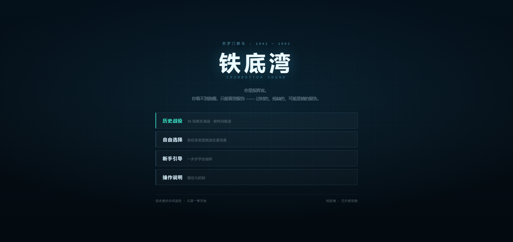
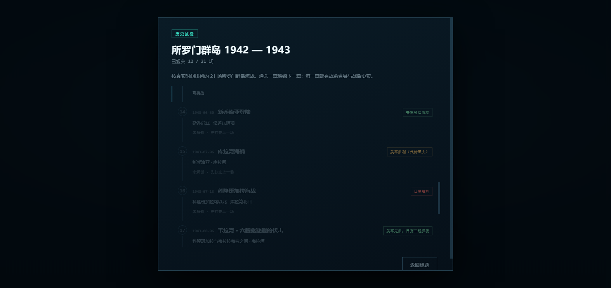
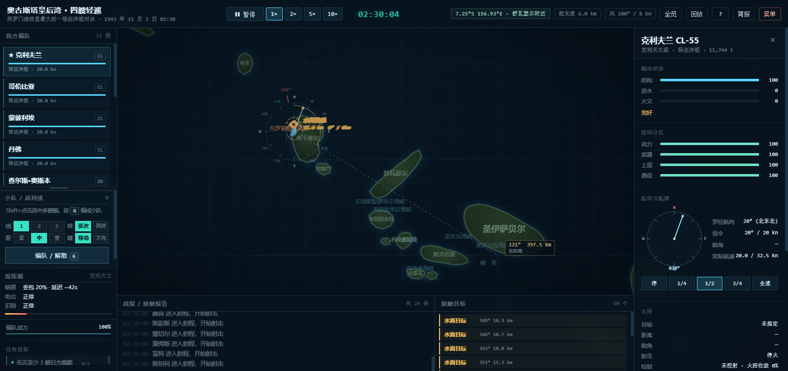
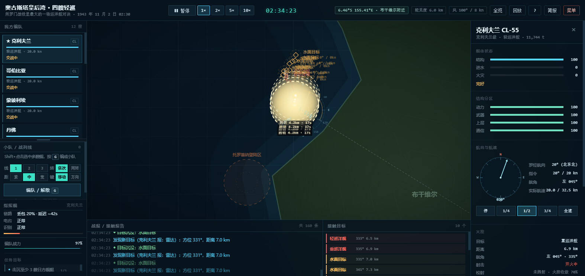
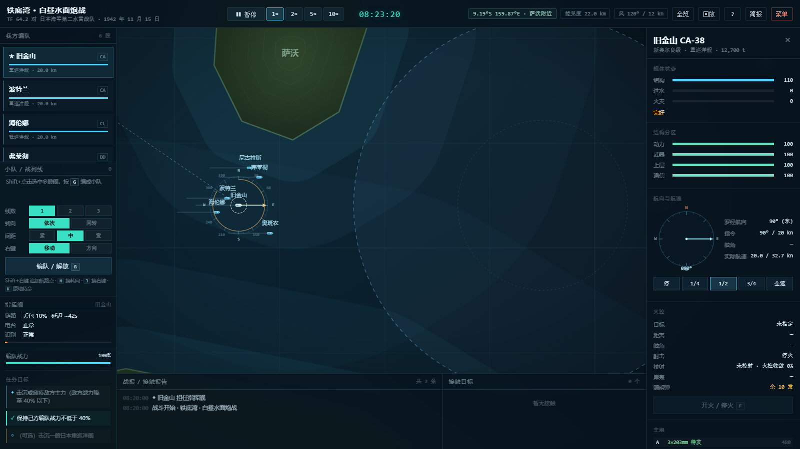
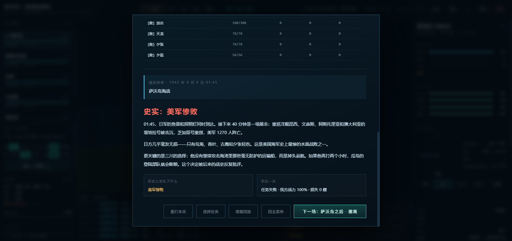

# 铁底湾 1942 · 所罗门海战

一个纯前端的二维二战水面舰艇战术游戏。以 1942—1943 年所罗门群岛海域为背景，
模拟美日双方驱逐舰与巡洋舰的炮战、鱼雷战与信息对抗。

**当前版本包含 21 个可玩场景**，按 5 种任务类型分组：
水面炮战、夜间护航、掩护登陆、对岸炮击、掩护撤退。全部取材于
1942—1943 年所罗门群岛的真实海战（萨沃岛、埃斯佩兰斯角、塔萨法隆加、库拉湾、
科隆班加拉、布莱克特海峡、韦拉湾、奥古斯塔皇后湾、圣乔治角等）。

---

## 在线试玩

**<https://hiworldcat.github.io/ironbottom-sound/>**

打开就能玩，不用装任何东西。存档（战役进度）会存在浏览器本地。

---

## 运行

不需要安装任何东西，也不需要服务器：

**双击 `index.html`** 即可在浏览器中开始游戏（推荐 Chrome / Edge）。

也可以双击 `启动游戏.bat`。

> 注意：`file://` 下浏览器不允许写 localStorage，所以直接双击打开时战役进度只在本次会话里有效。
> 想存进度就用上面那个在线地址，或者在本目录跑 `python -m http.server` 再用 `http://localhost:8000` 打开。

---

## 截图

| | |
|---|---|
|  |  |
| 标题画面 | 21 章历史战役线 |
|  |  |
| 960 × 600 公里海图 | 奥古斯塔皇后湾，22 艘舰 |
|  |  |
| 舰体结构分区 | 战后史实与回放 |

---

## 场景

双击 `index.html` 先看到**标题画面**，四个入口：

| 入口 | 内容 |
|---|---|
| **历史战役** | 21 场真实海战按时间排成一条线，一章一章往下打；每章有战前背景与战后史实 |
| **自由选择** | 按任务类型分组列出全部场景，随便挑 |
| **新手引导** | 7 步，边打边讲：选舰、下令、编队、转向、开火、鱼雷、信息不透明 |
| **操作说明** | 键位与机制速查 |

选一个任务看简报再进入战位。战斗结束后可以重打本关、换一个任务，或者
**观看整场海战的回放**。

### 水面炮战

| 场景 | 阵营 | 时间 | 核心机制 |
|---|---|---|---|
| 铁底湾 · 白昼水面炮战 | 美 | 昼间 | 双方对等的主力对决，击退对方编队 |
| 埃斯佩兰斯角 · 夜战 | 美 | 夜间 | 雷达先发现、T 字横切；日军有九三式鱼雷 |
| 萨沃岛 · 夜战混战 | 美 | 夜间 | 3 公里内混战，识别彻底失效，双方都打得准 |

### 夜间护航

| 场景 | 阵营 | 时间 | 核心机制 |
|---|---|---|---|
| 铁底湾 · 夜间护航 | 美 | 夜间 | 保护 2 艘运输船穿过海峡；你有雷达，对方没有 |
| 库拉湾 · 增援拦截 | 美 | 夜间 | 边护送船队进锚地，边挡住日方增援 |
| 塔萨法隆加 · 拦截运输队 | 美 | 夜间 | 拦住田中的“东京快车”，小心它转向时的鱼雷 |

### 掩护登陆

| 场景 | 阵营 | 时间 | 核心机制 |
|---|---|---|---|
| 图拉吉 · 掩护登陆 | 美 | 拂晓 | 敌舰突入登陆区累计 90 秒即失败；运输船会持续挨炮 |
| 伦加角 · 第一波登陆 | 美 | 拂晓 | 卸载进度决定胜负，敌舰进区会打断卸载 |
| 新乔治亚 · 夜登陆 | 美 | 夜间 | 夜里的赛跑：先卸完就赢，但能见度只有 4 公里 |

### 对岸炮击

| 场景 | 阵营 | 时间 | 核心机制 |
|---|---|---|---|
| 瓜岛 · 炮击登陆区 | 日 | 夜间 | 点选舰艇后点击岸上目标即可岸轰，摧毁 2 处目标 |
| 马坦尼考 · 炮击日军阵地 | 美 | 夜间 | 同样的岸轰流程，但日方水雷战队会从北面压下来 |
| 亨德森机场 · 夜袭 | 日 | 夜间 | 三艘重巡夜袭机场，美军反应部队半小时内赶到 |

### 掩护撤退

| 场景 | 阵营 | 时间 | 核心机制 |
|---|---|---|---|
| 铁底湾 · 掩护撤退 | 美 | 夜间 | 把受创的巡洋舰带到撤离区，不要恋战 |
| 萨沃岛之后 · 撤离 | 美 | 拂晓 | 运输船只能跑 12 节，日方三艘重巡在后面追 |
| 维拉拉维拉 · 掩护撤离 | 美 | 夜间 | 三艘驱逐舰挡住四艘日舰，把撤离舰送出去 |

每个场景有独立的兵力编成、能见度、时间限制与胜负判定。运输船、受创撤退舰由 AI
驾驶，玩家只能指挥作战舰艇（编队列表里标着「AI 驾驶」）。

---

## 标题画面与历史战役线

### 标题画面

开局是一张独立的标题画面，不是弹窗：上面是标题、下面是四个入口。
游戏本身要等你选完才加载（`?autostart=1` 可以跳过，调试和录视频时用）。

### 历史战役线

21 个场景按**真实发生的时间**排成一条线。每章三样东西：

* **战前背景** —— 当时双方在干什么、为什么打这一仗、你手上是什么牌；
* **这一仗你要做什么** —— 直接给出任务目标；
* **战后史实** —— 打完之后，结算页下方追加真实结果与它对战局的影响。

| # | 章节 | 场景 | 史实结果 |
|---|---|---|---|
| 1 | 图拉吉登陆 | 掩护登陆 | 美军登陆成功 |
| 2 | 伦加角登陆 | 掩护登陆 | 美军登陆成功 |
| 3 | 马坦尼考河口炮击 | 对岸炮击 | 舰炮支援奏效 |
| 4 | **萨沃岛海战** | 水面炮战 | **美军惨败** |
| 5 | 萨沃岛之后 · 撤离 | 掩护撤退 | 美军撤退 |
| 6 | 埃斯佩兰斯角海战 | 水面炮战 | 美军胜利 |
| 7 | 瓜岛炮击 | 对岸炮击 | 日军炮击成功 |
| 8 | 亨德森机场夜袭 | 对岸炮击 | 日军炮击成功 |
| 9 | 第一次瓜达尔卡纳尔海战 | 夜间护航 | 美军惨胜 |
| 10 | **第二次瓜达尔卡纳尔海战** | 水面炮战 | **美军胜利** |
| 11 | 塔萨法隆加海战 | 夜间护航 | 日军胜利 |
| 12 | 铁底湾 · 掩护撤退 | 掩护撤退 | 美军撤退 |
| 13 | **布莱克特海峡海战** | 水面炮战 | **美军完胜** |
| 14 | 新乔治亚登陆 | 掩护登陆 | 美军登陆成功 |
| 15 | 库拉湾海战 | 夜间护航 | 美军胜利（代价重大） |
| 16 | 科隆班加拉海战 | 水面炮战 | 日军胜利 |
| 17 | **韦拉湾海战** | 水面炮战 | **美军完胜** |
| 18 | 霍拉尼乌海战 | 夜间护航 | 各有得失 |
| 19 | 韦拉拉维拉海战 | 掩护撤退 | 日军撤退成功 |
| 20 | **奥古斯塔皇后湾海战** | 水面炮战 | **美军胜利** |
| 21 | **圣乔治角海战** | 水面炮战 | **美军完胜** |

**解锁与存档**：第一章永远可玩，之后每一章要求上一章通关。进度存在
`localStorage` 的 `naval.campaign.v1` 里；`file://` 或隐私模式下存不了就只在本次
会话里记着，功能不受影响。想从头再来，在浏览器控制台执行
`Naval.Campaign.reset()`。

注意：史实结果和你打出来的结果**是两回事**。第 4 章史实上美军惨败，你完全可能打赢；
结算页会把「历史上发生了什么」和「你这一仗」并排放在一起。战役线的解锁只看你有没有
打完，不看输赢 —— 输了也算通关，可以继续往下打。

### 新手引导

从标题画面进，7 步，边打边讲：

| 步 | 内容 | 判定 |
|---|---|---|
| 1 | 编队列表是什么、报告可能是旧的 | 选中任意一艘舰 |
| 2 | 右键给航向；指令航向与当前航向的区别 | 下一道航向命令 |
| 3 | Shift 多选 + `G` 编成小队 | 小队数量 > 0 |
| 4 | `H` 切换依次 / 同转 | 有队伍切成同转 |
| 5 | 接触不是敌舰；指定目标 + `F` 开火 | 有舰艇在开火 |
| 6 | 鱼雷只有驱逐舰有；要从舷侧打 | 发射鱼雷（或按下 T 但舷侧没对准） |
| 7 | 你看到的一切都是估计 | 讲解，点「下一步」 |

引导用的是「白昼水面炮战」这个场景，开局直接推进到双方刚接触的那一刻
（否则按 1× 要 5 分钟雷达上才出现第一个接触），够你把流程走一遍。
做到就自动进下一步；15 秒没做到会放出「跳过这步」，随时可以右上角「跳过」退出。

---

## 这一版做了什么

* **所罗门群岛 960 × 600 公里的真实海图**：19 座岛 / 群岛（北到布卡岛与新爱尔兰南端，
  南到圣克里斯托瓦尔），近岸水深带、等高线、海峡标注；含陆地碰撞与搁浅判定。
* **21 个场景各在自己真正发生的那片水域**：库拉湾在科隆班加拉与新乔治亚之间、
  科隆班加拉在岛以北、韦拉湾在科隆班加拉与韦拉拉韦拉之间、奥古斯塔皇后湾在布干维尔
  西岸、圣乔治角在布卡岛以北，不再全挤在图拉吉门口（见「地形与航行」）。
* 美日双方共 12 个舰级：新奥尔良级重巡 / 布鲁克林级 / 克利夫兰级 / 亚特兰大级轻巡 /
  弗莱彻级驱逐舰 / 运输船；妙高级重巡、川内级轻巡、阳炎级 / 白露级 / 吹雪级驱逐舰、
  大发艇。克利夫兰级没有鱼雷发射管，纯靠 12 门 6 英寸炮 —— 鱼雷得靠驱逐舰放。
* 逐炮塔的火炮控制、逐发炮弹的弹道与命中判定、装甲穿透、进水、火灾、殉爆、沉没。
* **结构分区**：舰体之外还有上层建筑 / 武器 / 通信 / 动力四块独立血条，
  打光哪块就成比例丧失对应能力（没炮、没无线电、没雷达、开不动）。
* 九三式氧气鱼雷与 Mk 15 鱼雷的差异（射程、航迹可见性、可靠性）；
  **鱼雷引信触发概率随吨位上升**（驱逐 64% / 重巡 93%）。
* **搁浅与撞船**：按撞击速度的平方结算结构损伤、动力损失与进水；
  撞船还要乘上双方吨位比，小船吃亏。
* **信息不透明**：你看不到敌舰本体，只能看到带误差的航迹。
* **指挥舰与无线电**：全舰队的信息要先报到指挥舰，视距外走无线电 —— 有延迟、会丢包；
  己方舰的状态和位置同样如此。夜战和恶劣天气丢包率更高。旗舰沉了会指挥中断再交接。
* **小队指挥长**：小队 30 秒没有新指令，就由队首那艘舰的舰长接管。
* **21 个场景、5 种任务类型**，多数取材于真实海战；任务选择界面按类型分组。
  其中韦拉湾、圣乔治角是**纯驱逐舰**任务 —— 手上没有巡洋舰，只能靠鱼雷和速度。
* **顶栏一直告诉你现在在哪**：视野中心的经纬度和海域名（「8.04°S 157.37°E · 库拉湾附近」），
  拖图时跟着变；离最近的岛或海峡超过 55 km 就写「开阔海域」。
* **回放溯源**：放大回放后，每一处水柱与每一条鱼雷都会标出发射舰、口径，
  以及发射当时我方是否发现过它。
* **航向角度指示器**：选中舰艇后海图上会画出罗经刻度环（每 10° 一格、每 30° 标数字），
  实线是当前航向、琥珀虚线是指令航向，两者之间画出转向弧并标注「左/右 xx°」；
  右侧详情面板里还有一个航向盘，同步显示当前 / 指令航向与舷角。
* **全程回放**：整场战斗按秒记录双方真实舰位、航迹、鱼雷、水柱、烟幕与照明弹，
  结束后可以拖动时间轴复盘。
* **左栏可调**：舰艇列表与小队面板之间有一条可拖动的分隔条，两块都按比例伸缩，
  比例自己定、不再写死；装不下时各块自己滚，不会溢出屏幕。
* **标题画面 + 历史战役线**：开局先进标题画面（历史战役 / 自由选择 / 新手引导 /
  操作说明），不再是直接弹一个任务列表。战役线把 21 个场景按真实时间串起来，
  每章带**战前背景**和**战后史实**，通关解锁下一章，进度存在浏览器里。
* **新手引导**：7 步，自动判断你有没有做到（选中 / 下令 / 编队 / 切转向 / 开火 / 鱼雷），
  做到就自动进下一步；15 秒没做到会把「跳过这步」放出来，不会卡死。
* **界面统一**：标题画面、战役线、战前简报、战后史实、结算页共用一套
  面板 / 按钮 / 字号 / 间距，战役线用同一条时间轴。

---

## 操作

| 操作 | 说明 |
|---|---|
| 左键点选舰艇 | Shift 多选；点空处取消选择 |
| 左键点击敌方接触 | 指定为目标（随后按 F 开火） |
| 左键点击岸上目标 | 让选中舰艇对岸炮击（仅岸轰场景有效） |
| **上下拖动左栏分隔条** | 调整「舰艇列表」与「小队面板」的高度比例；双击恢复默认 |
| 右键点海图 | 下达航向命令（编队保持相对位置） |
| 拖拽 / 滚轮 | 平移 / 缩放 |
| `F` | 开火 / 停火 |
| `T` | 鱼雷齐射（需要把舷侧转向目标） |
| `S` | 施放烟幕 |
| `L` | 发射照明弹（夜间照亮鼠标所指海域） |
| `G` | 把选中的舰艇编成小队 / 再按一次解散 |
| `H` | 切换小队转向方式（线转 / 同转） |
| `J` | 切换右键命令（战列线移动 / 战列线方向） |
| `K` | 小队清空航路，原地待命 |
| `R` | 进入 / 退出战斗回放 |
| `空格` | 暂停；回放中为播放 / 暂停 |
| `1` `2` `3` `4` | 时间倍率 1× / 2× / 5× / 10× |
| `Q` | 视野全览 |
| `Tab` | 切换舰艇 |
| `Esc` | 打开暂停菜单；弹窗打开时关闭弹窗；回放中为退出回放 |

### 左栏的两块可以拖着分

左栏从上到下是「舰艇列表」「小队面板」「指挥舰」「任务目标」四块。
舰艇列表和小队面板中间有一条**可拖动的分隔条**。

这两块**都是可伸缩的**：它们用 `flex: <grow> 1 0` 分掉左栏剩下的高度，
分隔条改的只是两个 grow 的**比例** —— 不是把哪一块的高度写死。
所以拖动是真的在改「展示区域」的大小，窗口拉大拉小两边还按同一个比例分。

* 上下拖动 → 分隔条跟着鼠标走，两块此消彼长；
* **双击** → 恢复默认（小队面板占 40%）；
* 比例存在 `localStorage`（`naval.squadBoxFrac`），下次进来还是你调过的样子；
* 两块都有下限（舰艇列表至少露出一艘舰，小队面板至少露出标题栏），拖到底也不会消失。

装不下的时候各滚各的：小队面板自己滚（队形按钮也在里面），任务目标在自己那一格里滚，
舰艇列表自己滚；整栏只在窗口矮到连固定块都放不下时才兜底滚一下。

实测（1600×900，左栏可用高度 688 px，6 艘舰、卡片 59 px）：

| 状态 | 舰艇列表 | 小队面板 | 能看到的舰 |
|---|---|---|---|
| 默认 | 285 px | 155 px | 4 艘 |
| 往下拖 200 | **394 px** | 46 px（到底） | **6 艘全见** |
| 往上拖 200 | 198 px | **242 px** | 3 艘 |

1600×1100 下默认就是 417 / 223 —— 6 艘一次全见。
1600×768 下默认 197 / 111（3 艘），往下拖到 262（4 艘）。
三种窗口高度下整栏都没有溢出（`scrollHeight == clientHeight`）。

### 界面出口

界面上没有“进得去出不来”的界面 —— 顶栏右侧的 **菜单** 按钮和 `Esc` 都能随时打开暂停菜单：

```
标题画面 ─┬─ 历史战役 → 战役线 → 战前简报 → 战斗
          ├─ 自由选择 → 任务列表 → 简报 → 战斗
          ├─ 新手引导 → 战斗（带分步讲解）
          └─ 操作说明 → 帮助

战斗中 ──Esc / 菜单──▶ 战斗暂停
                         ├─ 继续战斗   → 回到战斗
                         ├─ 重新开始   → 同一剧本重开
                         ├─ 选择任务   → 任务列表（有“返回”回到暂停菜单）
                         ├─ 观看回放   → 回放（退出后回到战斗/结算）
                         ├─ 操作说明   → 帮助（“知道了”回到暂停菜单）
                         └─ 回主菜单   → 标题画面

战斗结束 ──▶ 结算
              ├─ 重打本关 / 选择任务 / 观看回放 / 回主菜单
              └─ 下一场（战役线里才有，直接进下一章的战前简报）
```

其余弹窗同样都有出口：任务列表有 `返回`，战役线有 `返回标题`，战前简报有
`进入战位` + `返回战役线`，结算有 `重打本关` / `选择任务` / `观看回放` / `回主菜单`，
回放条有 `退出回放` / `返回结算`。
`HUD._ensureExit()` 还会给任何忘记加按钮的弹窗补一个 `关闭` 兜底。

命令下达后有传递延迟，而且**视距内外差别很大**：

* **视距内**（指挥舰能看见）：旗语 / 灯光，1~4 秒，不会丢。
* **视距外**：无线电，25~80 秒（按距离），还可能直接丢掉 —— 丢了就是丢了，
  提示里会写「命令丢失」，那艘舰不会动。

左栏「指挥舰」那一格实时显示当前旗舰、丢包率、电台与敌我识别器的状态。
己方舰艇卡片上的「报告 xx s 前」表示这条信息有多旧。详见
[指挥舰与无线电](#指挥舰与无线电)。

选中舰艇后，把鼠标移到海图上会显示**方位 / 距离读数**（以所选舰艇为基准），
方便下达精确航向。

---

## 小队与战列线

Shift+点击选中多艘舰，按 `G` 编成一支**小队**。小队可以排成 1~3 条**战列线**
（左栏「小队 / 战列线」面板里切换）。编好之后，右键下的命令是给整条线的，
不是给某一艘舰的。

### 五分钟上手

下面这套操作打一遍，就把所有功能都用到了。

**第 1 步 · 编队。** Shift+点击选中 4 艘驱逐舰，按 `G`。左栏出现「第 1 小队」，
后面写着「4艘·1线 xxx° 18kn」。舰会自己收拢成一条纵队，大约 3~5 分钟排好。

> 舰已经在各自乱跑也没关系 —— 编队时程序会按“谁在前、谁在左”自动排序，
> 不会出现两条船抢同一个位置。

**第 2 步 · 让整条线转向。** 面板上「右键」保持 **移动**，在海图上点一个位置。
整条线会朝那个方向压过去，队首先转，后面的舰依次跟着转。

**第 3 步 · 给一条航线。** 按住 **Shift+右键** 再点第二个、第三个位置，
航路点会依次追加，海图上画出一条带编号的虚线航线。整条线会一段一段走过去，
到最后一个点自动停车。

> 点错了就 `Shift+右键` 重新点，或者右键一个单点覆盖掉整条航线。

**第 4 步 · 只改航向。** 面板「右键」切到 **方向**（或按 `J`），再点海图 ——
这次只改航向，不设终点，整条线一直朝那个方向开。追击、脱离、保持接触都用这个。

**第 5 步 · 对比两种转向。** 按 `H` 把「转向」切到 **同转**，再下一次方向命令。
你会看到完全不同的结果：所有舰同时把船头转过去，谁也不去追前舰的航迹，
原来的纵队在新航向上摊成了横队。同转时左栏的小队卡片会写「同转·不保持队形」，
图上也不再画战列线虚线和站位圈 —— 因为这时候根本没有战列线要保。

再按 `H` 切回 **依次**，下个方向命令，队形又会自己重新排成纵队。

**打起来的时候**：编队只接管航向航速，开火、选目标、放鱼雷、躲鱼雷都还是各舰
自己的事。想解除编队再按一次 `G`。

**第 6 步 · 感受一下无线电。** 开一个夜战场景（`night_escort` 或 `cape_esperance`），
左栏「指挥舰」那一格会写当前的丢包率 —— 夜间基础 10% 再加 10%，雾雨再加 14%，
所以通常是 34% 上下。

把一艘驱逐舰派到 20 km 以外，然后：

* 它卡片上的血条、航速**不再实时**，会写「报告 xx s 前」并变暗；
* 海图上它的位置会**滞后**，还带一个虚线的不确定圈 —— 那是它最后一次报上来的位置；
* 你给它下命令，提示会从「旗语已传递」变成「无线电已发出（约 60 秒）」，
  偶尔还会直接告诉你「无线电里全丢了」。

再等 30 秒不管小队 —— 战报里会跳出一行「无新指令，由 XX 舰长接管指挥」，
小队自己动起来了。你随便下个命令，它马上交还。

想看极端情况：把整支舰队开到离指挥舰 25 km 外，同时把「链路」那一栏的丢包率
看成本场的实时值 —— 这时候整张图都是几分钟前的战场。

### 「线数」是什么

面板上的 **线数 1 / 2 / 3** 不是舰艇编号，是**把小队拆成几条并排的纵队**。

`战列线`（battle line）是海军术语，指舰艇排成一条纵队、后舰跟着前舰的航迹走。
一条这样的纵队叫"一条线"。1 线就是全队排成一列；2 线是把小队拆成两条并排的
纵队，3 线拆成三条。这是 20 世纪前半叶舰队编队的标准做法 ——
多条线并排能在保持队形的同时展开火力。

以 5 艘舰、2 线为例（编号是程序按"谁在前、谁在左"自动排的）：

```
①  ②        ← 并排，中间隔一个「线距」（中档 1500 m）
③  ④
⑤

①③⑤ 在第 0 线（3 艘），②④ 在第 1 线（2 艘）
面板上就写成「5艘·2线(3+2)」
```

* **间距**（紧/中/宽）＝ 同一条线上，前后两艘的**纵向**间隔：600 / 900 / 1400 m。
* **线距** ＝ 两条线之间的**横向**间隔：900 / 1500 / 2200 m（跟间距一起换档）。
* 第 0 线压在领舰的航迹上，第 1、2 线依次向右舷排开 —— 所以 2 线编队的中心
  并不正好在航迹上，而是偏左半个线距。

### 各条线不必一样长（4+2 也行）

真实编队里 4+2、5+2+2 这种**不等长**的排法是常态 —— 重巡跟着重巡走，
驱逐舰在另一条线上当屏卫。所以这里不用"平均分"，而是让玩家自己摆：

```
基准  4      第 1 线  2
┌────────┐ ┌────────┐
│ ★弗莱彻 │ │ 海伦娜  │
│  奥班农 │ │ 尼古拉斯 │
│  斯特朗 │ └────────┘
│  库欣   │
└────────┘
```

左栏每支小队下面都摊开这张**队形盘**，一列一条线、一格一艘舰，
从上到下是前到后，`★` 是领舰。操作只有两个：

* **点两艘舰 = 交换站位**。领舰也能换，换完航迹从新领舰重铺。
* **点一艘舰，再点上方「基准 / 第 N 线」= 把它挪到那条线的末尾**。
  这就是 4+2 的来源：把第 1 线上的舰一个个挪到基准线上，直到剩下 2 艘。

规则：

* 各线长度不限，但**每条线至少留一艘**（想真正减少线数请用「线数」按钮）。
* 改完不用重新编队 —— 舰会自己开到新站位去，不用解散重来。
* 「线数 / 间距」按钮只作用于**当前选中**的小队；点某支小队的格子会顺便把它选中。

队形盘里的位置和「线数」是两套东西：点「线数」会**按行优先重新平均分配**
（因为那是在重新定义队形），而手动挪线是微调，不会被冲掉。

上面那支 6 艘 / 2 线的队伍，面板上写的是：

```
第 1 小队          依次
6艘 · 2线(4+2) · 330° 18kn   间900
```

括号里就是每条线各有几艘 —— 一眼看出是不是自己想要的形状。

3 条线时同理：

```
①  ②  ③
④  ⑤  ⑥
⑦  ⑧  ⑨
```

线数越多，队形越宽、转弯时扫过的面积越大，但也越容易被鱼雷一次覆盖多艘。
1 线（单纵队）最紧凑，是夜战和狭窄水道里的常规选择。

### 小队编号

小队按 **第 1 小队、第 2 小队……** 编号，规则是**取当前最小的空号**：

* 建了 1、2 两支，解散 1 号，下一支新建的又是 **1 号**；
* 1、2 都在的时候新建，是 **3 号**；
* 每局开始编号从 1 重新算，不会出现"上一局用到 5 号、这一局从 6 号开始"。

### 两种命令

| 命令 | 做什么 | 什么时候用 |
|---|---|---|
| **战列线移动** | 给一个（或几个）航路点，整条线沿着航线开过去，到点自动停车 | 转移阵位、抢占 T 字头、绕岛 |
| **战列线方向** | 只改航向，不设终点，全队一直朝那个方向开 | 保持航向巡航、边打边走 |

`Shift+右键` 追加航路点，普通右键替换整条航线。面板「右键」按钮或 `J` 切换模式。
下达后同样有 2~3 秒传递延迟。

### 两种转向：依次 vs 同转

这是整套东西的核心，两种方式的物理过程完全不同：

| | **依次转向**（默认） | **同转** |
|---|---|---|
| 谁先转 | 队首先转，后面的舰依次跟到同一个转弯点才转 | **所有舰同时**把船头转过去，转同一个角度 |
| 走什么线 | 后舰走的是**前舰压出来的同一条航迹** | 各舰各走各的直线/圆弧，**不追航迹** |
| 要不要保持战列线 | 要 —— 站位就是航迹上的等弧长点 | **不要** —— 没有站位这回事，掉队了也不补位 |
| 队形结果 | 还是纵队，间距不变 | 队形整体平移，相对新航向摊成横队 |
| 用时 | 长（要等尾巴走完那个弯） | 短（全队一起转完） |

**为什么依次转向必须是“沿航迹”而不是“整条线一起平移”？** 因为后者不是船能做的事。
一条 900 m 长的战列线如果像门板一样整体旋转，线上的每艘舰都得同时横向平移几百米 ——
船没有横向速度，物理上不可能。真实的 `turn in succession` 是：队首按自己的转弯半径
拐过去，第二艘开到队首开始拐的那个点、用同样的转弯半径拐，第三艘再晚一个身位……
整条线的形状是**队首航迹的等弧长平移**，所以每个弯都是同一段圆弧，只是时间上错开。

代码里就是照这个做的（`js/sim/squad.js`）：

```
领舰按命令开 → 每 12 m 把位置压进一条航迹折线 sq.track（按弧长参数化）
第 j 个站位  = 航迹上弧长 (trackLen - j*spacing) 处的点
每艘舰的参考航向 = 该点处的航迹切向
```

于是领舰怎么拐、拐多大弯，后面的舰就怎么拐、拐多大弯，只晚一点。
转弯半径、甩尾、切内角这些都不需要特判，是几何自然产生的。

**同转则完全不碰航迹**（`keepTogether()`）：每条舰只是把航向摆到队航向，
航速对齐队速，然后就没了 —— 不追航迹、不拆站位误差、不做横向修正。
各舰转弯半径一样，所以整队像刚体一样平移着转过去；原本的纵队相对新航向
自然成了横队。谁被打坏了掉队，也不会有人回去补位，这是同转和依次转向的根本区别。
界面上同转的小队不画战列线虚线和站位圈 —— 画了就是撒谎。

### 站位是怎么保持的

**只有依次转向才保持站位。** 每艘舰把“站位误差”拆成**沿航向**和**横向**两个分量：

* 横向误差 → 航向修正。用固定的前视距离换算（`atan2(横向误差, max(420, 纵向误差))`），
  所以不会因为纵向误差趋零而把舵打死、直接切内角；
* 纵向误差 → 航速修正。落后就加速、超前就减速，齐了回落到队速；
* 掉队超过 700 m 全速追；航速有 6 节保底，保证舵有效；
* 站位落在岸上会被挪到最近水面，队首前方是岸则整条线停下等新命令。

实测（无头测试，`tools/headless-test.mjs`）：

| 项目 | 结果 |
|---|---|
| 4 舰 2 线收拢（7 分钟） | 最大站位误差 **12 m** |
| 110° 依次转向后 | 各舰偏离领舰航迹 **12 m**，间距 909 / 900 / 900 m |
| 转向中途各舰航向差 | 依次 **180°**（队首已转完、队尾还没开始），同转 **0°**（全队一起转） |
| 纵队 4 舰改同转转 200° | 首尾间距 2661 → 2664 m（整体平移，没有重排） |
| U 形航线（3 个航路点，累计转向 276°） | 终点残余 179 m，后舰偏离航迹 4 m |

### 编队时舰艇还会自己打仗

编进小队只接管**航向和航速**，火控仍然是各舰自己的：自动分配目标、进射程开火、
鱼雷来了照样规避（规避时暂时脱离队形，躲完自己回位）。所以编队不影响战斗力，
只是把“各自为战”变成“整条线一起动”。

舰艇被击沉会自动移出小队、站位重排；小队打光了自动解散。

---

## 指挥舰与无线电

上一节说的是"你看不到敌舰"。这一节说的是更狠的一层：**你连自己人都不一定看得清。**

真实的特混舰队不会共享一张实时态势图。每艘舰的雷达、瞭望、测距仪各自看到一点碎片，
要靠无线电报到**指挥舰**上，指挥舰合成一张图，再把命令发回去。无线电就有两件事：

* **延迟** —— 你看到的是几十秒到两分钟之前的战场。距离越远越慢。
* **丢包** —— 有些消息发出去了，但没收到。你甚至不知道有这回事。

这套东西**美日双方完全一样**：双方各有一艘指挥舰，AI 用的也是自己那张（旧的）图，
不是真坐标。

### 什么时候是实时的，什么时候不是

| 情况 | 手段 | 延迟 | 丢包 |
|---|---|---|---|
| 指挥舰自己看到的 | 本舰雷达 / 瞭望 | 0 | 0 |
| 视距内的舰（能见度以内，最多 15 km） | 旗语 / 灯光 | 1~4 秒 | 不丢 |
| 视距外的舰 | 无线电 | 25~80 秒（按距离） | 见下表 |

注意"视距"是**光学**能见度，不是雷达距离。所以白天 22 km 能见度时，编队内基本是实时的；
一到夜间（能见度 3~4 km），整个舰队立刻掉进无线电模式 —— 这正是夜战最难受的地方。

### 丢包率

| 因素 | 附加 |
|---|---|
| 基础 | 10% |
| 夜间 | +10%（黄昏 +5%） |
| 雾 / 雨 / 暴 / 阴 | +14% |
| 满雨量 | +20% |
| 海况 ≥ 4 | +5% |
| 电子干扰 | 可叠加（预留接口，目前场景里为 0） |

全部**累加**。白昼 10%，夜间 34%，夜间再加 20% 干扰就是 54%。**延迟不随天气变化。**

### 具体影响到的四样东西

1. **敌方接触。** 态势图上的每条接触都带"报告于多少秒前"。报告之间的空档按估算航向
   外推，误差随时间涨。所以你会看到接触位置一跳一跳地修正 —— 那就是新报告到了。
2. **己方舰的状态。** 视距外的舰，血条、进水、火情、航速、航向全是旧报告。
   卡片会写"报告 59s 前"并变暗，图上那条舰也画在**旧位置**上（带虚线圈），
   不是它真正在的地方。**点选也是按图上的位置算的** —— 你点到哪艘，选中的就是哪艘。
3. **己方舰的位置。** 位置靠本舰导航，有 70 m 量级的常规误差，
   另有 6% 的概率出**粗大误差**（500~2400 m）—— 图上那艘舰会突然跳到几百米外。
4. **你下的命令。** 视距内几秒到；视距外走无线电，几十秒，还可能丢。
   丢了就是丢了，舰不会动，只会提示"命令丢失"。

### 硬件会被打掉

* **电台**（`radioDestroyed`）—— 指挥部位或上层建筑中弹时有概率损坏。
  坏了以后视距外的报告和命令全部中断，只剩旗语。
* **敌我识别器**（`iffDestroyed`）—— 每次识别有 **1%** 概率答错。
  答错的后果是双向的：敌人被当成友军（不出现在目标列表里），或者友军被当成敌人。
  识别器被打掉以后，所有接触一律"不明"，只能靠目视辨认。

### 指挥交接

指挥舰被打沉 → **指挥中断 35 秒**（这段时间里没有报告进来，命令也发不出去）→
由剩下吨位最大的舰接替。战报里会写清楚是谁接了指挥。

### 小队指挥长

小队还有一层：**指挥长**。默认是队首那艘舰的舰长。

* 你 30 秒没给新指令 → 指挥长接管，按**指挥舰的态势图**自己决定航向
  （图上没接触就保持航向；有接触就压到 11 km 左右；本队平均血量低于 45% 就脱离）。
* 你随时下命令 → 立刻交还，战报里写"恢复人工指挥"。
* 你给的是**航线**（多个航路点）→ 只要还没走完，指挥长不插手，因为那是在执行计划。

所以把小队丢在一边不管，它不会傻站着，但也不会打得比你聪明 —— 它看到的图和
你一样旧。

---

## 信息不透明是怎么做的

这是本作的设计核心：**玩家看到的不是战场，而是报告。**

1. **敌舰只有航迹。** 渲染层从不绘制敌舰的真实舰体，只画一个带误差圈的接触符号。
   航迹的位置由观测误差决定，失去接触后按最后测得的航向航速外推，误差随时间增大，
   超过 15 分钟自动消失。

2. **两套探测手段，各有短板。**
   * 雷达（美军 SG）：测距准（约 1%），测向差（2.5°），**无法识别舰种**。
   * 光学：测向准（0.8°），测距差（2%~8%），可识别舰种乃至舰名。
   * 目标开火闪光、起火、浓烟会显著增加被发现距离；烟幕会遮蔽目视观测但不影响雷达。
   * 日方 1942 年基本无雷达，只有优秀的光学指挥仪 —— 这正是史实中的不对称。

3. **四级识别**：水面目标 → 舰种 → 舰级 → 舰名。
   远距离只知道“有东西”，且有一定概率**误判舰种**（把驱逐舰报成轻巡之类）。

4. **看不到弹道。** 炮弹要飞 10~30 秒，你只能看到落水水柱。
   首发必然偏，靠**跨射**校射逐步收敛（火控收敛度会在右侧面板显示）。

5. **看不到敌舰损伤。** 只能从火光、浓烟、失速推断对方状态；
   战报里只会出现“观测到命中”“目标沉没”这类不确定的描述。

6. **鱼雷几乎不可见。** 九三式氧气鱼雷航迹可见度 0.04，只有瞭望哨在 2 km 内
   偶然发现才会报警；Mk 15 的航迹则明显得多。这是日方最大的战术优势，
   也是玩家最大的心理压力来源。

---

## 战斗模型

### 火炮

每座炮塔独立工作：转向（受射界限制）、俯仰、装填、备弹、被击毁。

* 射界：前向炮塔不能向后射击，后向炮塔不能向前射击。
* 装填：按各炮实际射速（8"/55 约 3.2 发/分，6"/47 约 8 发/分，5"/38 约 12 发/分）。
* 备弹：每门炮 160 发。

### 弹道与命中

* 飞行时间 = 距离 / (初速 × 0.72)，随距离增加。
* 落点散布为椭圆：沿射向的误差远大于横向。
* 误差来源：火炮本身散布、火控质量、**火控收敛系数**（errorScale）、航迹陈旧程度。
* 命中判定：落点是否落在目标舰体矩形内（考虑舰长、舰宽）。
* 落角由距离决定，落角大于 22° 时更容易击中水平甲板。

### 装甲与穿透

命中部位按权重抽取：舷侧 / 水线 / 甲板 / 机舱 / 炮塔 / 舰桥 / 上层建筑。

* 舷侧、水线、机舱、舰桥 → 比对**舷侧装甲**
* 甲板 → 比对**水平装甲**（远距离落角大时更有意义）
* 炮塔 → 比对炮塔装甲，未击穿可能跳弹

穿深表按距离插值，例如 8"/55 在 0 / 10 / 20 km 分别为 254 / 142 / 74 mm。
结果分三档：穿透 / 部分穿透 / 未击穿。

日舰的甲板与炮塔装甲明显偏薄（妙高级甲板 37 mm、炮塔 25 mm），
在远距离被 8 英寸炮弹吊射时非常吃亏 —— 这是史实。

### 损伤

* **结构值**：归零即沉没。
* **进水**：命中水线或鱼雷会造成持续进水，累积到 100% 沉没；损管会逐步堵漏。
* **火灾**：持续烧蚀结构，火势过大有概率**弹药库殉爆**（瞬间沉没）。
* **结构分区**：见下节。动力、武器、上层建筑、通信各有独立血条。
* **炮塔**：被击毁后该炮塔永久失效，舰艇战力随之下降。

### 结构分区

一艘舰不是一块铁。它的结构强度按比例分给五块，除了舰体主血条之外，
另外四块各有一条独立的血条：

| 分区 | 重巡占比 | 驱逐占比 | 打光之后 |
|---|---|---|---|
| 舰体 hull | 44% | 40% | 沉没（就是主血条） |
| 上层建筑 | 15% | 12% | 雷达与火控指挥仪一起报废，火控散布急剧放大 |
| 武器结构 | 19% | 24% | 全部炮塔与鱼雷管失效；掉一半时射速降到约七成 |
| 通信结构 | 6% | 5% | 无线电与敌我识别中断，只剩旗语（视距内） |
| 动力结构 | 16% | 19% | 航速归零 |

各分区的满值按比例从主血条换算：

```
该区满值 = cls.hull × (该区比例 / 舰体比例)
```

一艘 110 点结构的新奥尔良级，武器结构就是 `110 × 0.19 / 0.44 ≈ 47.5` 点。
打光这 47.5 点，炮就彻底哑了 —— 不需要先把整条舰打沉。驱逐舰的武器结构占比
更高（0.24/0.40），意味着它**更容易被打哑**，但主血条更短，沉得也更快。

炮弹的命中部位直接决定打哪个分区：

| 命中部位 | 主要伤害分区 |
|---|---|
| 舷侧 / 水线 | 舰体（水线附带一点动力） |
| 甲板 | 上层建筑为主，武器为辅 |
| 机舱 | 动力结构 |
| 炮塔 | 武器结构 |
| 舰桥 | 通信结构 + 上层建筑 |
| 上层建筑 | 上层建筑（附带一点通信） |

鱼雷主要打舰体与动力。**能力是成比例下降的，不是非黑即白**：武器结构剩七成，
装填速度大约剩八成；剩一半，约剩六五成。

### 鱼雷

| | 九三式氧气鱼雷 | Mk 15 |
|---|---|---|
| 口径 | 610 mm | 533 mm |
| 战雷头 | 490 kg | 375 kg |
| 航速 | 48 节 | 45 节 |
| 射程 | 20 000 m | 6 000 m |
| 航迹可见度 | 0.04（几乎不可见） | 1.0（明显） |
| 可靠性 | 0.85 | 0.72（早期引信问题） |

鱼雷按发射瞬间的提前量直线航行，不做任何制导。
发射管必须大致对准目标舷侧（相对方位 32°~148°），装填需要数分钟。

**触发概率随吨位上升。** 几何上大船本来就更好打（舰体矩形更大），但真正决定
"炸不炸"的是引信：驱逐舰干舷低、吃水浅，鱼雷常常从龙骨底下穿过去；重巡干舷高、
吃水深、舰体长，触发引信几乎必然动作。

| 吨位 | 1500 t | 2500 t（驱逐） | 10 000 t（轻巡） | 13 000 t（重巡） |
|---|---|---|---|---|
| 触发概率 | 55% | 64% | 89% | 93% |

所以一次鱼雷攻击对大舰的期望命中数远高于对小舰 —— 两种效应叠加，
驱逐舰被鱼雷命中的概率大约只有重巡的四分之一。

---

## 场景接口

战斗内核（`sim/` 下的 world / sensors / combat / ai）**完全不知道具体场景**，
只消费 `data/scenarios.js` 里的数据。新增场景不需要改动仿真层。

### 写坐标请用经纬度

手写本地米坐标（`-30000, -5000`）既看不懂、又容易把战场放到海里或者岛上。
`scenarios.js` 顶部提供了几个帮手：

```js
vessel(side, group, cls, name, lon, lat, hdg, spd, role, hull, extra)
//   一条船，写它自己的经纬度、航向（度，0=北）、航速（节）
zone(id, name, kind, lon, lat, r)             // 登陆区 / 撤离区 / 目标区
shore(id, name, kind, lon, lat, hp)           // 岸上目标
N.MAP.at(lon, lat)                            // → { x, y }，米
N.MAP.lx / N.MAP.ly                           // → 单个分量
```

一条船一行，队形就是这一行行坐标本身：

```js
vessel('US', 'TF 67.4', 'neworleans', '旧金山', 159.965, -9.100, 320, 18, 'flagship', 'CA-38'),
vessel('US', 'TF 67.4', 'neworleans', '波特兰', 159.968, -9.103, 320, 18, 'cruiser',  'CA-33'),
vessel('US', 'TF 67.4', 'fletcher',  '库欣',   159.972, -9.108, 320, 18, 'screen',   'DD-376'),
```

`role` 取 `flagship` / `cruiser` / `screen` / `transport` / `escortee`；
`extra` 是原样并入舰对象的附加字段（`damage`、`destination`、`aiRole`、`pursue` 等）。
剧本里**不再有** `relocate()` 和 `PLACES` 表 —— 每条船的坐标就是它历史上的位置，
`tools/scenario-check.mjs` 会检查没有一条船被生在岛上。

一个场景是一个纯数据对象：

```js
{
  id: 'night_escort',
  title: '铁底湾 · 第一次瓜岛夜战',
  subtitle: '卡拉汉的巡洋舰队在黑暗里撞上阿部弘毅的炮击编队',
  date: '1942 年 11 月 13 日 01:50',
  startTime: 6600,              // 当日秒数
  timeOfDay: 'night',           // day | night | dawn | dusk
  available: true,              // 是否已实现
  tags: ['夜战', '护航'],

  env: {                        // 环境直接决定探测距离与火控质量
    visibility: 3600,           // 米
    windDir: 100, windSpeed: 8, seaState: 2,
    weather: '阴，无月', light: 'night', rain: 0
  },

  playerSide: 'US',
  forces: [                     // 双方编成（本地平面坐标，米）
    { side: 'US', class: 'fletcher', name: '弗莱彻', x: 0, y: 0,
      heading: 90, speed: 15, group: 'TF 67.4', role: 'screen' },
    { side: 'US', class: 'transport', name: '麦考利', role: 'transport',
      destination: { x: -14000, y: -5000 } },          // 自己开往目的地
    { side: 'US', class: 'neworleans', name: '明尼阿波利斯', role: 'escortee',
      aiExitZone: 'exit', damage: { hull: 0.45, flood: 15, power: 15 } },
    { side: 'JP', class: 'myoko', name: '妙高', aiRole: 'raid', pursue: true }
  ],

  zones: [                      // landing / exit / objective / patrol
    { id: 'exit', name: '撤离区', kind: 'exit', x: -14000, y: -5000, r: 3200 }
  ],

  shoreTargets: [               // 岸上目标（岸轰用）
    { id: 'airfield', name: '亨德森机场', kind: 'airfield', x: 0, y: -19600, hp: 600 }
  ],

  objectives: [                 // 任务目标，check(world) 返回进度
    { id: 'escort_through', text: '至少 1 艘运输船抵达撤离区', kind: 'primary',
      check: function (world) { return { progress: 0.5, done: false, note: '1/2' }; } }
  ],

  victory: { timeLimit: 1800 }, // 时限；具体胜负由下面的 check 决定
  check: function (world) {     // 返回 { result:'win'|'loss'|'draw', reason } 或 null
    return null;
  },
  update: function (world, dt) {},   // 每帧钩子（登陆区压制、增援等）
  onStart: function (world) {},

  search: { JP: { x: -12000, y: -6000 } },  // 无目标时 AI 前往搜索的海域
  home:   { US: { x: 22000, y: 12000 } }    // 脱离时的集结海域
}
```

`role` / `aiRole` 的含义：

| 字段 | 取值 | 行为 |
|---|---|---|
| `role` | `transport` | AI 驾驶，开往 `destination`，到达后停船 |
| `role` | `escortee` | AI 驾驶，全速驶向 `aiExitZone` 指定的区域 |
| `aiRole` | `bombard` | 无敌人时自动寻找岸上目标并进入射程 |
| `aiRole` | `raid` | 无视交战结果，优先冲进 `landing` 区域 |
| `pursue` | `true` | 无目标时以 92% 最大航速搜索，而不是巡航速度 |
| `damage` | `{hull,flood,fire,power,steering}` | 开局损伤预设（0~1 或百分比） |

`type` 字段决定场景在任务选择界面里归到哪一组，取值见 `Scenarios.types()`：

| `type` | 分组 |
|---|---|
| `surface` | 水面炮战 |
| `escort` | 夜间护航 |
| `landing` | 掩护登陆 |
| `bombard` | 对岸炮击 |
| `retreat` | 掩护撤退 |

`js/data/scenarios.js` 里还提供了几个写场景用的小工具，省得手算坐标：

```js
column('US', 'TF 64', -30000, -5000, 10, 20, [   // 从领舰位置沿航向反向排一条纵队
  { c: 'neworleans', n: '旧金山', hull: 'CA-38', role: 'flagship', gap: 0 },
  { c: 'brooklyn',   n: '海伦娜', hull: 'CL-50', role: 'cruiser', gap: 2000, off: 1400 }
])
objSink(world, 'JP', 2)   // “击沉 2 艘” 的标准目标判定
```

---

## 文件结构

```
index.html              页面骨架
启动游戏.bat            双击启动
css/style.css           战术指挥台风格样式
js/
  core.js               数学 / 随机 / 地理 / 时钟 / 事件总线
  data/
    ships.js            火炮、鱼雷、舰级数据（美日双方）
    scenarios.js        场景注册表、海图轮廓、场景定义
    campaign.js         历史战役线：16 章的背景 / 史实 / 进度存档
  sim/
    sensors.js          探测与航迹（信息不透明的核心）
    ship.js             舰艇实体：运动、炮塔、损伤
    combat.js           火控解算、弹道、命中、鱼雷、岸轰
    ai.js               战术 AI（同样只用航迹，不读真实坐标）
    recorder.js         战斗录像与回放采样
    squad.js            小队与战列线（队形几何、站位保持、两种转向、指挥长）
    command.js          指挥舰、无线电链路（延迟/丢包）、本舰状态报告、敌我识别
    world.js            世界容器、主循环、区域/岸上目标、胜负判定
  view/
    renderer.js         Canvas 渲染（海图、航迹、航向环、战列线、区域、照明弹）
    hud.js              DOM 界面（编队、指挥舰、小队面板、详情、航向盘、目标、回放条）
    screens.js          标题画面、战役线、战前简报、战后史实
    tutorial.js         新手引导（分步判定 + 自动推进）
  main.js               启动、标题画面/场景选择、输入、游戏循环、回放
tools/
  headless-test.mjs     无头仿真测试（逐个场景跑，检查数值与稳定性）
  dom-smoke-test.mjs    DOM 冒烟测试（场景选择/渲染/HUD/回放路径）
  scenario-check.mjs    场景清单：分组、兵力、出生点/锚点是否在陆地
  land-probe.mjs        地形碰撞专项
  attr-probe.mjs        回放溯源数据统计（水柱/鱼雷有没有带发射舰）
  cmd-probe.mjs         指挥链路专项（旗舰、延迟、丢包、IFF、交接）
  squad-ai-probe.mjs    小队指挥长接管/交还专项
  shot-stats.py         截图色彩统计（无图形环境下的视觉验证）
  band-probe.py         按色带统计画布像素
  warm-probe.py         暖色团块检测（岸上目标/区域圈）
  panel-probe.py        侧栏面板像素检测（航向盘）
  check-canvas.py       海图元素连通域检测
```

---

## 地形与航行

### 地图范围

战场覆盖**所罗门群岛**，经纬度 152.55°E–161.3°E、4.55°S–9.95°S，大约 960 × 600 公里：

* 19 座岛 / 群岛：新爱尔兰（南端）、布卡、布干维尔（含奥古斯塔皇后湾）、肖特兰、
  舒瓦瑟尔、韦拉拉韦拉、吉佐、科隆班加拉、新乔治亚、伦多瓦、特特帕雷、圣伊萨贝尔、
  拉塞尔、瓜达尔卡纳尔、佛罗里达、图拉吉、萨沃、马莱塔、圣克里斯托瓦尔。
* 投影是**局部等距圆柱**，参考点 158.5°E / 8.3°S；`x` 向东、`y` 向北，单位米。
  在这个范围内误差可以忽略。
* 剧本里的坐标现在可以用经纬度写：`N.MAP.at(lon, lat)` / `N.MAP.lx` / `N.MAP.ly`。
  以前那些“随手写个 −30000, −5000”的坐标，正是所有战役都糊在图拉吉门口的原因。

### 每个战役都在它真正发生的那片水域

剧本里的每一条船都直接写着它的经纬度与航向，没有“先摆好再整体平移”这一步。
下面是 21 个场景的战场、双方起始位置和参战兵力（起始位置取该方队形的中心）。

| 场景 | 史实水域 | 美方起始 | 日方起始 | 美方兵力 | 日方兵力 |
|---|---|---|---|---|---|
| 铁底湾 · 白昼水面炮战 | 萨沃岛以东（架空态势，教学关） | 159.78, −9.18 | 160.08, −9.18 | 旧金山、波特兰、海伦娜、弗莱彻、奥班农、尼古拉斯 | 妙高、羽黑、长良、敷波、时雨 |
| 铁底湾 · 第一次瓜岛夜战 | 萨沃岛以东 | 159.97, −9.15 | 159.89, −9.02 | 旧金山、波特兰、亚特兰大、朱诺、海伦娜、库欣、拉菲、奥班农、斯特雷特 | 比叡、雾岛、长良、晓、雷、夕立、春雨 |
| 图拉吉 · 掩护登陆 | 图拉吉以北 | 160.05, −9.16 | 159.94, −9.03 | 海伦娜、圣路易斯、芝加哥、帕特森、巴格利 + 2 运输船 | 鸟海、青叶、古鹰、夕凪、岚 |
| 瓜岛 · 炮击登陆区 | 伦加角外海 | 160.10, −9.22 | 159.88, −9.20 | 海伦娜、弗莱彻、奥班农、尼古拉斯 | 妙高、羽黑、雪风、浜风 |
| 铁底湾 · 掩护撤退 | 铁底湾 | 159.91, −9.20 | 159.77, −9.12 | 明尼阿波利斯（受创）、海伦娜、弗莱彻、奥班农、尼古拉斯 | 妙高、羽黑、雪风、浜风、时雨 |
| 埃斯佩兰斯角 · 夜战 | 瓜岛西北 · 埃斯佩兰斯角以西 | 159.47, −9.23 | 159.77, −9.21 | 旧金山、盐湖城、海伦娜、博伊西、法伦霍尔特、邓肯、拉菲、布坎南 | 青叶、古鹰、衣笠、吹雪、初雪 |
| 萨沃岛 · 夜袭铁底湾 | 萨沃岛以北 | 159.88, −9.06 | 159.97, −9.12 | 堪培拉、阿斯托里亚、昆西、文森斯、帕特森、布鲁 | 鸟海、青叶、古鹰、衣笠、加古、天龙、夕张、夕凪 |
| 库拉湾 · 增援拦截 | 科隆班加拉与新乔治亚之间 | 157.22, −8.14 | 157.26, −7.98 | 海伦娜、圣路易斯、檀香山、尼古拉斯、奥班农、雷德福、詹金斯 + 3 运输船 | 新月、长月、皋月、夕凪、天雾、初雪 |
| 塔萨法隆加 · 拦截运输队 | 塔萨法隆加角外海 | 160.04, −9.30 | 159.81, −9.21 | 明尼阿波利斯、新奥尔良、彭萨科拉、檀香山、北安普顿、弗莱彻、珀金斯、莫里、杜拉尼 | 高波、长波、亲潮、黑潮、江风、凉风 |
| 伦加角 · 第一波登陆 | 伦加角锚地 | 159.97, −9.31 | 159.86, −9.14 | 芝加哥、波特兰、海伦娜、帕特森、巴格利 + 2 运输船 | 鸟海、青叶、夕凪、岚 |
| 新乔治亚 · 夜登陆 | 布兰奇海峡（伦多瓦以北） | 157.25, −8.47 | 157.29, −8.32 | 檀香山、圣路易斯、尼古拉斯、奥班农、泰勒 + 2 运输船 | 新月、长月、皋月、时雨 |
| 马坦尼考 · 炮击日军阵地 | 马坦尼考河口外海 | 160.00, −9.30 | 160.14, −9.22 | 海伦娜、圣路易斯、檀香山、尼古拉斯、奥班农 | 夕凪、岚、江风、时雨 |
| 亨德森机场 · 夜袭 | 伦加角外海 | 160.06, −9.22 | 159.88, −9.21 | 弗莱彻、奥班农 | 金刚、榛名、长良、照月、村雨、五月雨、时雨 |
| 萨沃岛之后 · 撤离 | 铁底湾 | 159.85, −9.20 | 159.76, −9.11 | 芝加哥（受创）、帕特森、巴格利 + 2 运输船 | 鸟海、青叶、天龙、夕张 |
| 维拉拉维拉 · 掩护撤离 | 韦拉拉韦拉岛以北 | 156.76, −7.54 | 156.71, −7.49 | 塞尔弗里奇、谢瓦利埃、奥班农 + 自走炮登陆舰 | 夕云、矶风、时雨、五月雨 |
| 科隆班加拉 · 夜战 | 科隆班加拉岛以北 · 库拉湾北口 | 157.06, −7.90 | 157.12, −7.78 | 檀香山、圣路易斯、利安得、尼古拉斯、奥班农、泰勒、詹金斯、雷德福、拉尔夫·塔尔博特、布坎南、格温 | 神通、雪风、浜风、清波、夕凪、凉风 |
| 布莱克特海峡 · 雷达伏击 | 科隆班加拉以南 · 布莱克特海峡 | 156.98, −8.28 | 157.01, −8.21 | 克利夫兰、蒙彼利埃、丹佛、康威、沃勒、普林格尔 | 村雨、峰云 |
| 韦拉湾 · 六艘驱逐舰的伏击 | 科隆班加拉与韦拉拉韦拉之间 | 156.88, −7.94 | 156.95, −7.88 | 邓拉普、克雷文、莫里、朗、斯特雷特、斯塔克 | 岚、萩风、川风、时雨 |
| 霍拉尼乌 · 拦截驳船队 | 韦拉拉韦拉岛以北 | 156.80, −7.56 | 156.70, −7.50 | 尼古拉斯、奥班农、泰勒、切瓦利尔 | 滨风、矶风、狭雾、时雨 + 3 驳船 |
| 奥古斯塔皇后湾 · 四艘轻巡 | 布干维尔岛西岸 · 奥古斯塔皇后湾 | 155.42, −6.44 | 155.40, −6.34 | 克利夫兰、哥伦比亚、蒙彼利埃、丹佛 + 8 驱逐舰 | 妙高、羽黑、川内、阿贺野 + 6 驱逐舰 |
| 圣乔治角 · 31 节追击 | 布卡岛以北 · 圣乔治角外海 | 154.16, −5.12 | 154.26, −5.04 | 查尔斯·奥斯本、克拉克斯顿、戴森、康弗斯、斯彭斯 | 大波、卷波、夕雾、卯月、天雾 |

几点说明：

* 位置按常见史料（Morison《Breaking the Bismarcks Barrier》/《The Struggle for Guadalcanal》、
  O'Hara《The U.S. Navy against the Axis》、combinedfleet.com 的战时履历）取到大约 1~3 公里。
* 舰名、舰级按实际参战序列；同一场战斗里双方舰数与本表一致。
* **本作没有战列舰**：比叡、雾岛、金刚、榛名用的是妙高级重巡的数据，只是名字对。
  她们的火力被低估、防护被高估，打起来会比史实更“耐揍”。
* 库拉湾（1943-07-06）的日方旗舰是**新月**，不是神通 —— 神通在 07-13 的科隆班加拉
  才被击沉，那一场单独做成了第 16 个剧本。
* 布莱克特海峡、奥古斯塔皇后湾的美方轻巡用**克利夫兰级**（12 门 6 英寸、无鱼雷发射管）；
  奥古斯塔皇后湾的日方轻巡川内、阿贺野分属川内级与阿贺野级，阿贺野级用川内级数据代替。
* 韦拉湾、圣乔治角是**纯驱逐舰**任务：双方都只有驱逐舰，鱼雷和航速决定胜负。
* 霍拉尼乌的驳船是**大发艇**（21 吨、8 节、9 点舰体）—— 一发 5 英寸炮弹就能打碎，
  但躲在驱逐舰的屏护后面，得先冲过去。
* 图拉吉、伦加两场登陆战里的运输船会先开进锚地（约 4 公里，十来分钟），
  到了就抛锚卸货 —— 名册上会挂一个「锚泊卸货」标签，别以为它卡住了。

### 海图长什么样

* **近岸水深**：以岛界为中心线画三层粗描边，露出水面的那一半就是从海岸向外变深的浅水带。
* **岛屿**：竖向渐变 + 向心收缩的等高线 + 山脊高光 + 浪花描边；缩得太小时只留色块。
* **标注**：岛名随缩放变大变小；海峡与海湾（铁底湾、槽海、库拉湾、布兰奇海峡、
  新乔治亚海峡、圣乔治海峡、韦拉拉韦拉海峡、印迪斯彭萨布尔海峡）单独标注。
* **网格**：5 公里一格，主网格（20 公里）在缩得较远时带 `123E` / `45N` 标尺。
* 相机最小缩放降到 `0.0012`（1600 px 约 1333 公里），整张图能一眼看完。

### 碰撞

舰艇**不会穿岛**，也不会停在岛上：

* **出生点校正**：剧本若把舰放在陆地上，`World` 会把它挪到最近水面，并记进
  `world.spawnFixups`。无头测试断言这个数组为空 —— 也就是说剧本坐标必须自己写对，
  校正只是兜底。
* **集结 / 搜索海域**同理（`world.posFixups`），AI 不会朝岛内的坐标开。
* **避障**：AI 沿航向前方 0.7 / 1.5 / 2.4 / 3.6 km 逐档探测，被挡时在 ±20°…±165°
  里挑一条能开得更远的方向；左右都通时，选**绕向目标那一侧**，并且锁定 12 秒避免摇摆。
* **撞岸**：船头（舰首前方 0.42 倍舰长处）触到陆地就算触底，**按撞击速度的平方**
  结算：结构、进水、动力结构、上层建筑一起挨，25 节以上冲上礁盘能把重巡打掉一半结构。
  触底后航速压到 4 节以内，只能朝最近水面慢慢蹭出去，舰体中心一步也不许再往陆地里走。
* **撞船**：两舰舰体矩形相交且沿连线方向有相对速度就算撞上。两舰都挨，
  按相对速度平方 × **对方吨位/自己吨位**结算 —— 驱逐舰迎头撞巡洋舰，
  吃亏的是驱逐舰（实测 24 节迎头：驱逐掉 58 点结构，巡洋舰掉 14 点）。
  撞完会把两舰每帧推开 1.2 m，避免卡在一起反复触发。
* **玩家下令**：右键点到陆地上会自动改成最近的海面，并提示「该处是陆地，已修正到最近海面」。

---

## 回放

整场战斗以 1 秒一帧记录，包含双方**真实**舰位、航向、航速、血量、**当时的指令航向与航速**、
运动轨迹、航迹、鱼雷、水柱、烟幕、照明弹与战报事件。战斗结束后在结算界面点「观看回放」，
或随时按 `R` / 顶栏「回放」进入。

回放中：

* 双方舰艇都按真实位置绘制，**敌方用橙红色**区分，并标出舰名与当前航速；
  底部还有「美军 N / 日军 M」的双方存活计数，确认两边都在画面里。
* 每艘舰身后拖着 **90 秒的运动轨迹**，一眼能看出谁在转向、谁在提速。
* 舰体与**指令航向**不一致时，会画一条琥珀色虚线指向它「正在转去的方向」——
  这就是当时的操作。
* 镜头默认**跟随**双方编队，自动保持能看清舰体的缩放；自己拖拽或滚轮缩放后
  自动停止跟随，点底部「跟随」按钮可以重新打开。
* 底部控制条可以拖动时间轴、播放/暂停、切换 1× / 2× / 4×。
* **战列线**也会跟着画出来：当时的站位虚线、站位圈、轴线与航向箭头，
  可以复盘“那条线当时是怎么转的”。
* 时间轴上的刻度是战报事件（红＝战损，橙＝沉没）。
* `空格` 播放/暂停，`←` `→` 前后跳 10 秒，`Esc` 退出。
* 回放条右端的按钮：战斗中进入回放显示「退出回放」，看完回放回到战斗；
  战斗已结束则显示「**返回结算**」，退出后回到结算界面，可以再来一局或换个任务。

### 状态流转

```
场景选择 → 简报 → 战斗 → (结束) → 结算 ─┬─ 再来一局 → 战斗
                                        ├─ 选择任务 → 场景选择
                                        └─ 观看回放 → 回放 ─┬─ 返回结算 → 结算
                                                            └─ (战斗中进入) 退出回放 → 战斗
```

任何时刻按 `R` 也能进回放；战斗中进的回放，退出后战斗从暂停处继续。

回放是**唯一**能看到敌方真实状态的场合 —— 战斗中依然只有带误差的航迹。

### 溯源标注（放大后自动出现）

回放里把画面放大到 **0.055 像素/米以上**（大约是能看清舰体的那一档），会给
炮弹落点和鱼雷补上“这一发是谁打的”：

* 同一艘舰最近的**水柱**旁边标 `<舰名> <口径>″`，例如 `旧金山 8″`，
  并用一条很淡的虚线连回开炮的舰。
* 每一条**鱼雷**在发射点标 `<舰名> 鱼雷`；如果这枚鱼雷在发射当时**没有被
  瞭望员发现**，再补一句 `（当时未发现）`。
* 标注按阵营着色：己方偏青，敌方偏橙。缩小到看不清的倍数就自动不再绘制，
  避免糊成一片。

这解决的是“自己瞭望员看不到就不展示”的问题：战斗中的可见性规则照旧，
回放是上帝视角，**双方每一发炮弹、每一条鱼雷都要能追溯**。鱼雷在回放里即使
当时未被发现也会画出来（暗色虚线），因为它是历史事实的一部分。

---

## 照明弹

夜战的核心工具，规则如下：

| 项目 | 数值 |
|---|---|
| 射程 | 朝鼠标所指海域，最远 6.5 km |
| 飞行时间 | 3.5 秒后爆燃 |
| 燃烧时间 | 50 秒 |
| 照明半径 | 4.2 km（海图上是虚线圆，标注剩余秒数） |
| 照明效果 | 圈内**任何舰艇**（不分敌我）的可见距离提升到 **11 km**，光学测距误差降低 40% |
| 弹药 | 重巡 10 发 / 轻巡 8 发 / 驱逐舰 5 发 / 运输船 0 |
| 装填 | 25 秒 |

要点：

* 它是**照亮一片海面**，不是标记一艘舰。圈里的目标谁都能看见——包括你自己。
  夜战里谁先打照明弹，往往意味着谁先准备好开炮，也意味着先暴露自己。
* 被照亮的敌舰更容易被识别（舰种 → 舰级 → 舰名），也更容易被跨射校射收敛。
* 按键 `L`，或点详情面板的「照明弹」按钮；面板上会显示剩余发数与装填倒计时。
* 敌方 AI 也会用照明弹：有雷达的美舰会在 4.5~11 km 上打，日舰靠光学发现后才会打。

---

## 测试

```bash
node tools/headless-test.mjs          # 全部剧本各跑两遍（被动 / AI 全自动）
node tools/headless-test.mjs night_escort
node tools/dom-smoke-test.mjs         # DOM + 交互 + 回放进出
node tools/land-probe.mjs all 777     # 地形碰撞专项（出生点 / 全场航行 / 锚点）
node tools/scenario-check.mjs         # 场景清单：分组、兵力、出生点/锚点修正
```

`scenario-check` 是加新场景时最有用的一个：它按任务类型列出所有场景，
并打印每艘舰的出生点、AI 搜索锚点有没有被挪过 —— **修正数不为 0 就说明坐标写到了岛上**。

`headless-test` 里除了数值与流程断言，还会检查：**没有任何舰艇在任何一帧压到陆地**、
出生点与 AI 锚点都不在岛上、照明弹的发射/爆燃/熄灭时序、回放快照的字段完整性、
以及指挥链路（视距内不丢包、远距离延迟与丢包率、夜间丢包率上升、IFF 1% 误判、
电台/识别器被打掉后的行为、旗舰交接、小队指挥长接管与交还）、
结构分区（打光武器区是否真的全炮哑火、通信/上层/动力是否各自对应无线电/雷达火控/航速、
只损一半时能力是否成比例下降）、鱼雷引信随吨位的触发概率、搁浅损伤与自行脱困、
撞船时两舰都受伤且小船吃亏。

`dom-smoke-test` 现在还会走一遍新界面：启动时标题画面可见 → 打开战役线（16 章）→
点开第一章的战前简报 → 返回战役线 → 返回标题 → 进自由选择，然后才是原来的战斗流程。

```bash
node tools/headless-test.mjs        # 逐个场景跑完整战斗（被动 + AI 对战）
node tools/headless-test.mjs night_escort   # 只跑指定场景
node tools/dom-smoke-test.mjs       # 用 DOM 桩驱动完整流程，抓运行期错误
```

无头测试会打印每艘舰的最终状态、战力剩余、命中数、任务目标完成度与岸上目标血量，
并对 NaN 坐标、战斗不结束、零命中、舰艇不动、卡在陆地、录像帧数过少等异常做断言。

调试用 URL 参数：

* `?autostart=1` 跳过标题画面、场景选择与简报直接开战
* `?campaign=1` 直接打开历史战役线
* `?tutorial=1` 直接进新手引导
* `?scenario=night_escort` 指定场景
* `?speed=5` 初始时间倍率
* `?advance=600` 开局直接推进 600 秒仿真（用于截图/复现）
* `?menu=1` 推进后打开暂停菜单（`&select=1` 再跳到任务选择）
* `?zoom=0.09` 覆盖初始缩放（同时关掉回放自动跟随）
* `?cam=4000,-7000` 把镜头放到指定海区（截图用，需配合 `?zoom=`）
* `?replay=1&rt=600` 直接进入回放并跳到第 600 秒
* `?squad=4&sqline=2&sqcourse=90&sqturn=together` 开局把前 4 艘可指挥舰编成小队
  （`sqline` 战列线条数、`sqcourse` 初始航向、`sqturn` 依次/同转），截图与验证用
* `?sqroute=x1,y1;x2,y2;...` 开局给小队一条航线（配合 `?squad=`）
* `?sqlanes=4,2` 开局把小队战列线设成 4 条 + 2 条（验证不等长战列线用）
* `?ss=1` 开局立刻打一发照明弹（截图 / 验证用）
* `?debug=1` 把相机与投影坐标写进 `body[data-debug]`（自动化验证用）；
  同一个 JSON 里还有 `posRead` / `area`（顶栏那条「8.04°S 157.37°E · 库拉湾附近」）

`?zoom=` 与 `?cam=` 在 `?replay=1` 之后生效 —— 进回放时的自动跟随会重置镜头，
所以这两个参数必须最后应用，否则会被跟随逻辑覆盖。

---

## 已知的简化

* 防空、舰载机、潜艇、登陆部队、岸上火力均未实现。
* 岛屿轮廓是手写的粗多边形（十几到二十几个点），能保证相对位置与海峡宽度大致正确，
  但不是测绘级海岸线；礁盘、浅滩、潮汐都没做。
* 战场只覆盖所罗门群岛中部；布干维尔北半、圣克里斯托瓦尔南端在图外被裁掉。
* 岸轰只做落点与固定伤害，没有岸上设施的分区毁伤。
* 炮弹只做落点判定，不模拟引信延时与水中弹道。
* 鱼雷只会命中敌舰，不会误伤友军（为可玩性做的妥协）。
* 结构分区只到"五块"这个粒度：不做逐个舱室、不做进水蔓延到相邻舱室，
  也不模拟损管分队的空间调度；损管只是让进水和火灾缓慢回落。
* 搁浅只判断舰体中心与舰首点是否落在陆地上，没有按吃水深度区分浅滩与深水。
* 回放按 1 秒采样，舰位在帧之间线性插值，快速转向时会有轻微折线。
* 日方 1942 年无雷达的设定让 AI 在昼间依赖光学；夜间场景里美方的雷达优势是刻意保留的。
* 小队最多 3 条战列线。第 0 号线压在领舰航迹上，其余各线向右舷依次排开，
  所以 2 线编队的中心并不正好在航迹上。
* 编队只接管航向航速，不会因为队形被挡就自动重新分配站位；也不会自动避开
  友舰（两艘舰抢同一个站位时会互相穿过去）。
* 航迹按 12 m 采样，站位取的是折线上的插值点，所以严格说转弯是“分段折线”
  而不是光滑圆弧 —— 采样密度下肉眼看不出来。
* 无线电延迟只跟**距离**有关，没有模拟中继、频率拥塞、天线高度、电离层。
  丢包是独立同分布的掷骰子，没有成串丢包（真实的短波衰落会连续丢几十秒）。
* 每艘舰每 9~17 秒发一次接触报告，状态报告每 11~16 秒一次；这是平均值，
  没有模拟"报务员忙不过来"。
* 敌我识别只有"敌 / 友 / 不明"三态，没有模拟应答机密码、雷达告警、无线电测向。
* 指挥交接只按吨位排序，没有模拟军衔、资历与临阵脱逃。
* 小队指挥长的判断比较粗（保持/接近/拉开/脱离四档），不会利用岛屿掩护，
  也不会跟其他小队协同。
* **没有战列舰**。比叡、雾岛、金刚、榛名用的是妙高级重巡的舰体与火炮数据，
  只有名字、数量和阵位是史实的 —— 所以她们的炮击威力偏小、抗沉性偏强。
* 剧本里的起始位置是按史料取整到 1~3 公里的近似值，不是逐舰的航海日志坐标；
  相对队形（谁在谁前面、间隔多少）是游戏性调的，不是史实队形。
* 同一场战斗里的舰数按实际参战序列，但个别护航舰（尤其是驱逐舰）
  为了不超出屏幕做了删减。

---

## 参考

* Samuel Eliot Morison, *History of United States Naval Operations in World War II*,
  Vol. IV *The Struggle for Guadalcanal* 与 Vol. VI *Breaking the Bismarcks Barrier* ——
  各场夜战的时间、兵力序列与战场位置主要据此。
* Vincent P. O'Hara, *The U.S. Navy against the Axis: Surface Combat, 1941–1945* ——
  炮战与鱼雷战的战术细节。
* combinedfleet.com 的 *Imperial Japanese Navy Page*（舰艇履历与战时行动记录）
  以及 NavWeaps 的火炮 / 鱼雷 / 装甲数据。
* 海图轮廓为示意性绘制，只保证相对位置与海峡宽度，不用于导航。
